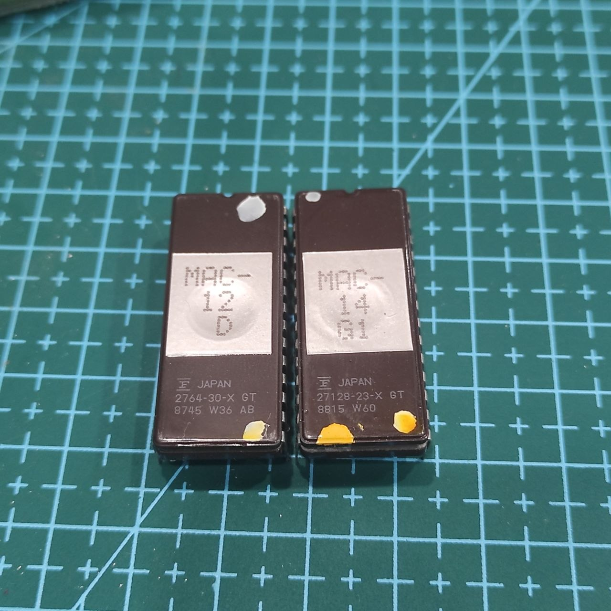

**Русский** · [English](README.en.md) · [Deutsch](README.de.md)

# Hitachi MAC-14 и MAC-12D

Дампы прошивок блоков управления Hitachi MAC-14 и MAC-12D и их листинги с комментариями на русском.

| Файл | Блок | Двигатель | EPROM | SHA-256 |
|---|---|---|---|---|
| `src/MAC-14.BIN` | MAC-14, 447905383L | MC (1988–1991) | MBM27128, 16 КБ, $C000–$FFFF | `a229f12c5f0fadd0214c420c67368cab571f0e1736263b6ccc484de028713d29` |
| `src/MAC-12D.BIN` | MAC-12D, 857905383 | 1B/2B (1988–1990) | MBM2764, 8 КБ, $E000–$FFFF | `407089b4111323564130cfe3333cd1fb94f1ae7f2ad20de5ac04ee586765375e` |

Процессор в обоих блоках HD63B03XP.

## Откуда дампы

Обе EPROM родные, из блоков. Прочитаны программатором XGecu T48 в программе Xgpro.



| Блок | Этикетка | Микросхема | Код даты |
|---|---|---|---|
| MAC-12D | MAC-12 D | Fujitsu 2764-30-X GT | 8745 (1987, 45-я неделя) |
| MAC-14 | MAC-14 G1 | Fujitsu 27128-23-X GT | 8815 (1988, 15-я неделя) |

## Состав

- `docs/asm/*.lst` — листинги. Листинг MAC-14 на английском и немецком: `docs/asm/en/`, `docs/asm/de/`.
- `docs/asm/*.notes` — разметка, из которой собирается листинг. Формат описан в `docs/asm/NOTES_FORMAT.md`.
- `src/*_pinout.md` — распиновки блоков, процессора и EPROM.
- `tools/lst6303.py` — дизассемблер HD6303.
- `tools/match6303.py` — ищет одинаковые участки кода в двух прошивках.

Листинг собирается так:

```
python3 -I tools/lst6303.py src/MAC-14.BIN docs/asm/MAC-14.notes > docs/asm/MAC-14.lst
```

Ключ `--cov` печатает покрытие кода разметкой, `--todo` — неразмеченные участки.

## Оговорки

Предположения в комментариях помечены `[Пр]`, неизвестное — `[?]`. Длина тика (≈ 10 мс) и
масштаб оборотов (≈ 22 об/мин на единицу) выведены из кода, на машине их не замеряли. Так же выведены
из кода единица углов в картах зажигания (1° на единицу) и то, что большее значение означает более позднюю
искру: стробоскопом это не проверено. Тип внешнего чипа по адресам $0100/$0101 не установлен.

## Лицензии

`tools/` — MIT, листинги и разметка — CC BY 4.0. На файлы прошивок эти лицензии не распространяются.
